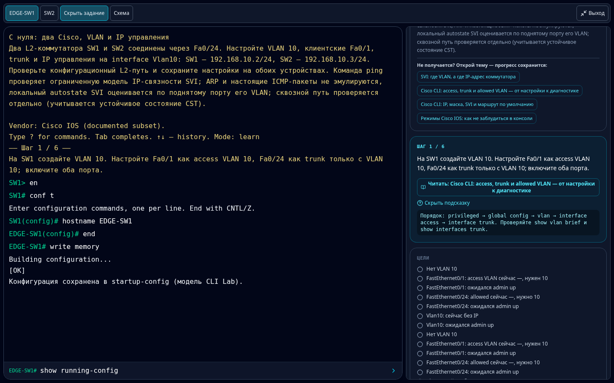
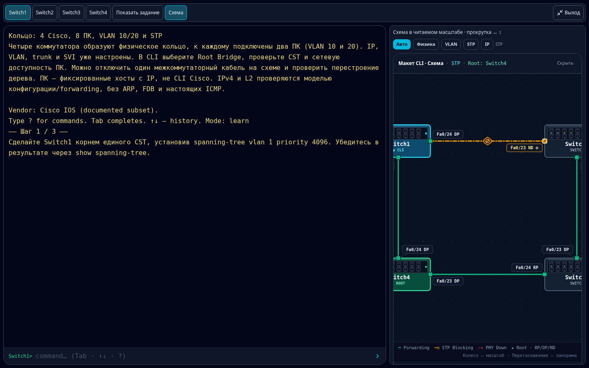
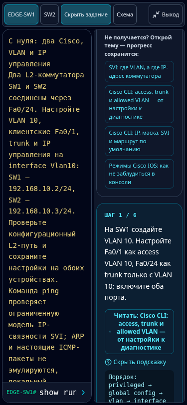
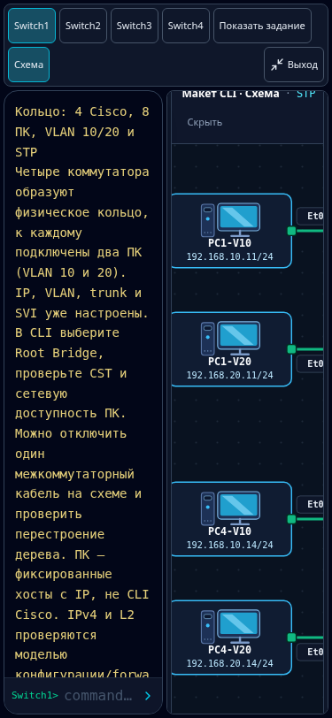

# Fullscreen CLI layout repair

Started from the requested rollback `14e72ee266a695e9c53bb971621556e4c18084f2`.
Reviewed reverted PR #148 (`ee9f925` / merge `c89e94e`) and its revert. Latest main
advanced to `2d176060e3d1c155ad0cafbfa424599bb5e7560a` during verification, adding only
`docs/ROADMAP.md`; this branch is rebased onto that main.

## Layout and preserved state

The fullscreen root uses the actual browser/visual viewport. A compact toolbar
contains switch selection, task toggle, scheme toggle where a topology exists,
and exit. The terminal consumes the rest of the height. Its input form cannot
shrink; only history scrolls. Closing the rail returns its width to the terminal.

One optional **right grid column**, not an absolute full-console overlay, contains
Tasks OR Topology. On narrow screens it takes half the available content width;
on larger screens it is capped at480px. Both terminal and rail remain usable.
The rail has its own scrolling; no background document scroll is needed.

Tasks retain the complete existing learning controls and content: scenario/mode
selection, command catalog/search, reset, current step, hints, theory links, goals,
checks and completion display. Opening a panel never invokes engine reset or
changes mode/scenario. Explicit Reset/mode/scenario buttons keep their established
behavior. All original task text and grading logic remain unchanged.

The topology remains **one mounted instance at one render site**. Grid placement
and hidden attributes move/show it; a second fullscreen renderer is not created.
Selected host/port, PC diagnostic input/output, topology layer and scroll position
survive task/topology toggles. Both existing renderers accept an opt-in scrollable
presentation; their network/STP/layout algorithms are unchanged.

The scrollable canvas uses existing complete graph bounds at readable near-native
scale, with horizontal scroll for its width and the rail for vertical content.
A narrow rail intentionally shows a viewport onto the larger diagram: offscreen
parts are reachable by scrolling, not removed or clipped out of its SVG. The
browser regression checks the actual rendered bounds of **all** ring devices,
lines and port labels against the full SVG, and exercises native touch scrolling.
Normal/windowed topology sizing and collapse choice remain unchanged.

The input and history DOM persist across fullscreen changes. The outer placeholder
reserves the old page height; body scrolling is locked only during fullscreen.
VisualViewport resize/scroll events keep the input above a reduced viewport.
Focus operations use preventScroll, keyboard focus stays within fullscreen/theory,
and exit restores the previous page position/focus. No automatic field focus is
introduced on panel open. Esc also dismisses an open theory overlay when exiting.

Unlike #148, tasks cannot cover the terminal, topology is available on mobile,
and scheme/learning content is not recreated as an independent fullscreen tree.

## Actual verification (2026-11-14)

- Chromium desktop1440×900 and touch/mobile375×812: **PASS** browser regression.
- Side panel geometry (right of terminal, no intersection); closed full width;
  pinned input; independent history scrolling with long output: PASS.
- Same input/SVG DOM, typed command, PC inspector result, hint visibility, catalog
  query and diagram scroll after toggles; SW1/SW2 switching; Learn step progression
  only from real commands; theory open/return: PASS.
- Configure, write memory, switch consoles, reload and verify configuration/history:
  PASS while panels remain available.
- Esc, exit button, Esc with theory open; windowed page/focus/overflow restoration:
  PASS. No page errors and no document jump during panel changes or command input.
- Four-switch/eight-PC ring: all SVG bounds fit the scrollable content at scale~0.97;
  native mobile horizontal/vertical touch scrolling: PASS.
- Short375×480 viewport resize: input stays visible/pinned. This exercises viewport
  resizing, **not a real iOS/Android on-screen keyboard**.
- TypeScript (`npm run lint`), production build (including prebuild), and
  `npm run test:logic`: PASS. Existing bundle-size warning remains.
- **32 of33 CLI test files PASS.** Existing `cli-reference.test.mjs:16` fails with
  `8 !== 6` (lesson-count assertion). The same failure was executed/reproduced on
  clean rollback14e72ee AND clean latest main2d17606. Neither that test nor lesson
  content is changed here. CI is expected to report that baseline failure.
- `git diff --check`: PASS. No engine, Cisco command, scenario, goal or question-bank
  changes. React review covered stable component identity, hooks/cleanup, focus,
  labelled controls, mobile input sizing and nested scroll behavior.

The legacy `cli-experimental-topology.test.mjs` has a hardcoded
`/tmp/cli-topology-redesign` resolveDir. A temporary symlink to this exact worktree
was used for the full local run, not an old checkout.

## Reproduce browser checks

Start `npm run dev -- --host 0.0.0.0 --port 5416`. The browser script is optional
and does not add production dependencies. Use an installed Playwright/Chromium:

```sh
CLI_PLAYWRIGHT_MODULE=/path/to/playwright-core/index.mjs \
CLI_CHROMIUM_PATH=/usr/bin/chromium \
CLI_BASE_URL=http://127.0.0.1:5416/my-gemini-mirror-site/ \
CLI_ARTIFACT_DIR=/tmp/netops-fullscreen \
node scripts/cli-fullscreen.browser.mjs
```

Without CLI_PLAYWRIGHT_MODULE it imports `playwright`; without CLI_CHROMIUM_PATH
it uses Playwright's browser. Results JSON and screenshots go to CLI_ARTIFACT_DIR.
The test fails on pane overlap, clipped intrinsic SVG bounds, document jumps,
state loss, offscreen input, broken commands or inaccessible learning controls.

## Screenshots

Actual Chromium viewport captures. Topology captures show the larger natural-size
scrollable canvas through the rail, not a scaled-down alternative diagram.

Desktop tasks/hints:



Desktop ring rail (scrollable):



Mobile tasks with usable CLI:



Mobile topology rail after native touch scrolling:


